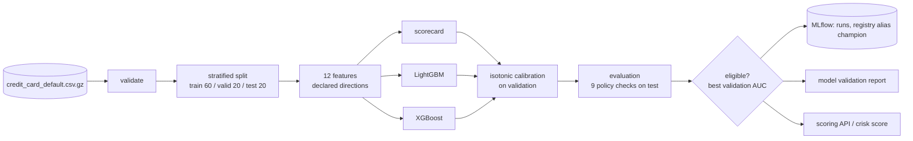

# Architecture



## Splits and what each is for

| Split | Rows | Used for |
|---|---|---|
| Train | 18,000 | Fitting, bins, WoE |
| Validation | 6,000 | Early stopping, calibration, the decision cutoff, choosing the champion |
| Test | 6,000 | Every reported number and every policy check |

## The decision rule

The cutoff is the raw-score quantile on validation that approves the policy's share of
applicants. Decisions compare the raw score with it; the calibrated PD is reported with each
decision and used for pricing and provisioning. Raw score and PD rank applicants identically,
because isotonic calibration is non-decreasing.

## Reason codes

- Boosted models: TreeSHAP contributions (log-odds), computed by LightGBM and XGBoost directly.
  Features with positive contributions raised this applicant's risk above the average; the four
  largest become reasons.
- Scorecard: points below the best attainable bin for each characteristic.

Each feature carries the wording used in adverse-action notices, in `features.py`.

## Persistence

```
artifacts/
  evaluation.json             every candidate's metrics, checks, cutoff; the champion's name
  models/<name>/model.json    kind, name, feature list (checked on load)
  models/<name>/booster.txt   LightGBM text model
  models/<name>/booster.json  XGBoost JSON model
  models/<name>/scorecard.json bins, WoE, coefficients, points
  models/<name>/calibration.json isotonic knots
```
